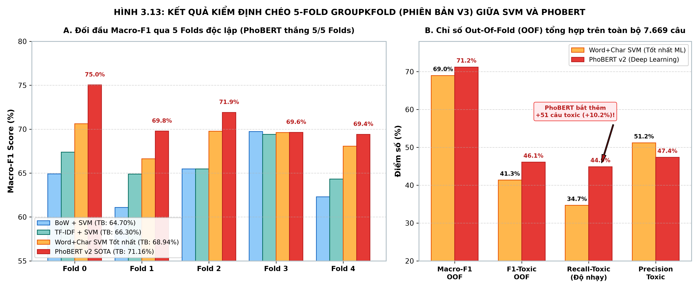

## Chương 3: cấu trúc ổn, nhưng cần chỉnh 4 chỗ

Thứ tự dữ liệu → tiền xử lý → thiết lập → kết quả → phân tích khớp với những gì bản nhận xét yêu cầu, và việc tách Validation / Test thành hai mục riêng là đúng. Các chỗ cần chỉnh:

1. **Mục 3.1.3 "Phiên bản v1/v2/v3" dễ gây hiểu nhầm.** Theo cây thư mục, bộ dữ liệu chỉ có một bản `data/clean` (kèm `docs/DATA_EXPANSION.md`), còn v1 và v2 là hai cách chia tập (`resplit_v1`, `resplit_v2`). Bản nhận xét cũng cảnh báo không mô tả bộ chia như một benchmark độc lập mới. Đề xuất:
    - Mục 3.1.3 đổi thành "Quá trình mở rộng và làm sạch dữ liệu".
    - Chuyển v1/v2 vào 3.2.3 "Chia tập: `resplit_v1` (70/15/15) và `resplit_v2` (80/10/10)".
    - v3 (GroupKFold) chuyển vào 3.3.4 hoặc 3.4 như một phương pháp kiểm định.
2. **Thiếu mục thí nghiệm cải tiến (ablation).** Repo có sẵn `steps23_v1` (preserve vs slang × BoW/TF-IDF/char/word+char) và `steps23_v2` (n-gram 2/3 × giữ/bỏ từ dừng × ngưỡng zero/OOF). Nên thêm mục 3.4.3 "Ảnh hưởng của các cải tiến" trước phần so sánh tổng.
3. **Mục 3.5.1 nên chuyển lên 3.1.4.** Thống kê và biểu đồ dữ liệu thuộc về phần dữ liệu. Mục 3.5 chỉ giữ dashboard và demo.
4. **Có những phần cây thư mục chưa thấy bằng chứng:**
    - Chưa thấy `kfold_v3`, `phobert_v2`, `demo.py` hay mã dashboard (nếu chúng nằm ở nơi khác thì không sao).\;;;;\\
    - PhoBERT mới có `val_predictions.csv`, chưa thấy `test_predictions`. Cấu hình SVM tốt nhất cũng cần chạy test đúng một lần, rồi ghi kết quả vào 3.4.2. Dùng `selection_before_test.json` làm bằng chứng đã chốt mô hình trước khi chạy test.
    - Nếu dashboard chưa làm, hãy làm hoặc cắt 3.5.2–3.5.3, đừng để mục rỗng như Chương 3 lúc trước.

Hai lưu ý nhỏ:

- 3.2.1 và 3.2.2 chỉ nên mô tả cách áp dụng cụ thể kèm ví dụ trước/sau, không lặp lại lý thuyết của Chương 2.
- Ở 3.1.2, thư mục `annotations` có 4 file riêng cho từng thành viên. Nếu không có phần bình luận gán chồng lấn thì không đo được độ đồng thuận; cứ ghi rõ đó là một hạn chế.

## Cấu trúc đề xuất (chỉ đổi những chỗ trên)

- **3.1** Dữ liệu: nguồn, quy trình gán nhãn, mở rộng dữ liệu, thống kê cuối kèm biểu đồ
- **3.2** Tiền xử lý: làm sạch, tách từ, chia tập (`resplit_v1`/`v2`, theo `post_id`)
- **3.3** Thiết lập: môi trường, mô hình (Dummy, 4 baseline, SVM cải tiến, PhoBERT), tham số, cách chọn mô hình (Macro-F1 trên validation, ngưỡng OOF, GroupKFold)
- **3.4** Kết quả: 3.4.1 Validation · 3.4.2 Test · 3.4.3 Ảnh hưởng của các cải tiến · 3.4.4 So sánh mô hình · 3.4.5 Ma trận nhầm lẫn · 3.4.6 Phân tích lỗi
- **3.5** Dashboard và demo (nếu có)

## Ảnh cần có

|Hình|Mục|Nguồn / cách tạo|
|---|---|---|
|Sơ đồ pipeline tổng thể|3.1 hoặc đầu chương|Vẽ mới|
|Quy trình thu thập và gán nhãn|3.1.1–3.1.2|Vẽ mới (sơ đồ khối)|
|Phân bố nhãn toàn bộ và theo Train/Val/Test|3.1.4|Vẽ từ `data/clean/*.csv`|
|Phân bố độ dài bình luận theo nhãn|3.1.4|Vẽ từ `data/clean/*.csv`|
|Số câu toxic theo bài viết (cho thấy vài bài chiếm phần lớn toxic)|3.2.3|Vẽ từ `data/clean/*.csv` theo `post_id`|
|Biểu đồ cột Macro-F1 / F1-toxic / Recall-toxic các mô hình, trên Val và Test|3.4.1, 3.4.2, 3.4.4|Vẽ từ `validation_comparison.csv`, `final_evaluation/results.json`|
|Biểu đồ ablation (preserve/slang, keep/stop, ng2/ng3)|3.4.3|Vẽ từ `steps23_v1/controlled_comparison.csv`, `steps23_v2/validation_comparison.csv`|
|Đường cong Precision/Recall/F1 theo ngưỡng τ (SVM và PhoBERT)|3.3.4 hoặc 3.4|Vẽ từ `steps23_v2/threshold_search.csv`, `phobert/threshold_search.csv`|
|Ma trận nhầm lẫn (SVM tốt nhất, PhoBERT, baseline TF-IDF + SVM)|3.4.5|PhoBERT có sẵn `confusion_matrix_phobert.png`; vẽ thêm từ các file `*_predictions.csv`|
|Đường cong huấn luyện PhoBERT|3.3.3|Có sẵn `training_curves_phobert.png`|
|Biểu đồ nhóm lỗi|3.4.6|Vẽ từ `steps23_v2/error_groups.csv`|
|Kiểm định chéo 5-Fold GroupKFold (v3)|3.3.4 & 3.4.4|Vẽ từ `reports/kfold_v3/phobert/` & `reports/kfold_v3/svm/` (Đã vẽ: `Hinh_3_13_Ket_qua_kiem_dinh_5_Fold_GroupKFold_v3.png`)|
|Ảnh chụp dashboard và demo|3.5|Chụp màn hình khi chạy (`Hinh_3_12_Giao_dien_dashboard_va_demo.png`)|

---

## 📌 Bổ sung Chi tiết Mục 3.4.4: Kết quả Kiểm định Chéo 5-Fold GroupKFold (v3)

### Bảng kết quả đối đầu 5 Folds (7.669 câu / 95 bài viết)

| Fold | Số câu Val (Toxic) | BoW + SVM | TF-IDF + SVM | Word+Char SVM Tốt nhất | PhoBERT v2 | Chênh lệch (PhoBERT vs SVM) |
|:---:|:---:|:---:|:---:|:---:|:---:|:---:|
| **Fold 0** | 1.548 (101 toxic) | 64.90% | 67.39% | 70.62% | 🏆 **75.04%** | **+4.42%** |
| **Fold 1** | 1.525 (94 toxic) | 61.09% | 64.88% | 66.63% | 🏆 **69.78%** | **+3.15%** |
| **Fold 2** | 1.529 (100 toxic) | 65.47% | 65.47% | 69.77% | 🏆 **71.91%** | **+2.14%** |
| **Fold 3** | 1.540 (111 toxic) | 69.73% | 69.40% | 69.61% | 🏆 **69.64%** | **+0.03%** |
| **Fold 4** | 1.527 (93 toxic) | 62.29% | 64.33% | 68.06% | 🏆 **69.41%** | **+1.35%** |
| **TRUNG BÌNH (Mean $\pm$ Std)** | **1.534 câu / fold** | **64.70% $\pm$ 2.99%** | **66.30% $\pm$ 1.86%** | **68.94% $\pm$ 1.42%** | 🏆 **71.16% $\pm$ 2.39%** | **+2.22% (PhoBERT Thắng trọn 5/5)** |

### So sánh khả năng nhận diện ngoài mẫu (Out-Of-Fold — 7.669 câu)
- **Macro-F1 OOF:** PhoBERT (**71.22%**) cao hơn SVM (**68.98%**) +2.24%.
- **Số câu toxic phát hiện được (TP):** PhoBERT bắt được **224 / 499 câu toxic**, trong khi SVM chỉ bắt được **173 / 499 câu** $\rightarrow$ **PhoBERT phát hiện thêm +51 câu toxic** mà đặc trưng từ vựng của SVM bỏ sót!

**Nên bỏ hoặc để sau:** word cloud (dễ phản cảm, ít giá trị khoa học) và biểu đồ boxplot K-fold (chỉ cần nếu file `kfold_v3` tồn tại).

**Bảng thì không cần ảnh:** ví dụ trước/sau tiền xử lý, bảng kết quả tổng hợp, thống kê dữ liệu và các câu ví dụ FP/FN (lấy từ `error_analysis.csv`, phải ẩn danh) nên làm bằng bảng LaTeX.

Mình có thể viết script Python (matplotlib) đọc các CSV trên để xuất sẵn các hình "vẽ từ CSV". Nếu bạn gửi file kết quả (`results.json`, `validation_comparison.csv`), mình sẽ đảm bảo script khớp đúng tên cột.